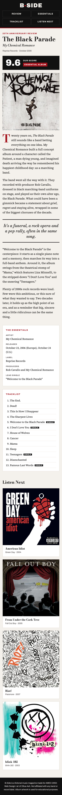
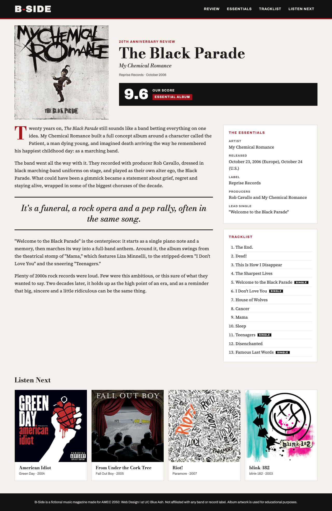

# 🎸 B-Side: Responsive Album Reviews

[← Back to the README](../README.md)

## 🎯 Overview

B-Side is a fictional music magazine with a homepage and five album reviews. The HTML and the base styles are already
done, but the site only has a phone layout: everything stacks in one column, no matter how wide the screen is.

In this exercise you'll make it responsive. Working mobile-first, you'll create `css/breakpoints.css`, link it on every
page, and use CSS Grid, Flexbox, and media queries to add layouts for tablets and desktops.

> [!TIP]
> Follow along with the companion video. It walks through every step, from creating the stylesheet to the finished
> desktop layout.

## 🧠 What You'll Practice

- Writing mobile-first CSS: the phone layout comes first, and each media query adds to it
- Naming page regions with `grid-template-areas` and rearranging them at a breakpoint
- Building a card grid that adjusts on its own with `repeat(auto-fit, minmax(...))`
- Switching the nav from a grid to a Flexbox row
- Adding `min-width` media queries in `rem`

## 🖼️ Finished Album Page

The site uses two breakpoints:

| Screen  | Width                | What changes                                                     |
|---------|----------------------|------------------------------------------------------------------|
| Phone   | Under 48rem (768px)  | One column. The nav is a 2×2 grid under the logo.                |
| Tablet  | 48rem (768px) and up | The nav moves beside the logo in one row.                        |
| Desktop | 60rem (960px) and up | The album art sits beside the title, and the sidebar moves right. |

The "Listen Next" cards fit as many columns as the screen allows, with no media query.

<table>
  <tr>
    <th>Phone</th>
    <th>Desktop</th>
  </tr>
  <tr>
    <td valign="top"></td>
    <td valign="top"></td>
  </tr>
</table>

## 📂 Starter Files

| File / Folder   | Purpose                                                                          |
|-----------------|----------------------------------------------------------------------------------|
| `index.html`    | The homepage, with a card for each album                                         |
| `albums/`       | One review page per album                                                        |
| `css/base.css`  | Colors, fonts, spacing, and the phone layout. Leave this file as it is.          |
| `images/`       | Album covers in WebP format                                                      |

You'll add `css/breakpoints.css` yourself during the video.

## 📚 Resources

- [MDN: Using media queries](https://developer.mozilla.org/en-US/docs/Web/CSS/CSS_media_queries/Using_media_queries)
- [MDN: Grid template areas](https://developer.mozilla.org/en-US/docs/Web/CSS/CSS_grid_layout/Grid_template_areas)
- [CSS-Tricks: A Complete Guide to CSS Grid](https://css-tricks.com/snippets/css/complete-guide-grid/)
- [CSS-Tricks: A Complete Guide to Flexbox](https://css-tricks.com/snippets/css/a-guide-to-flexbox/)

---

The AI policy and submission instructions are in the [README](../README.md).
